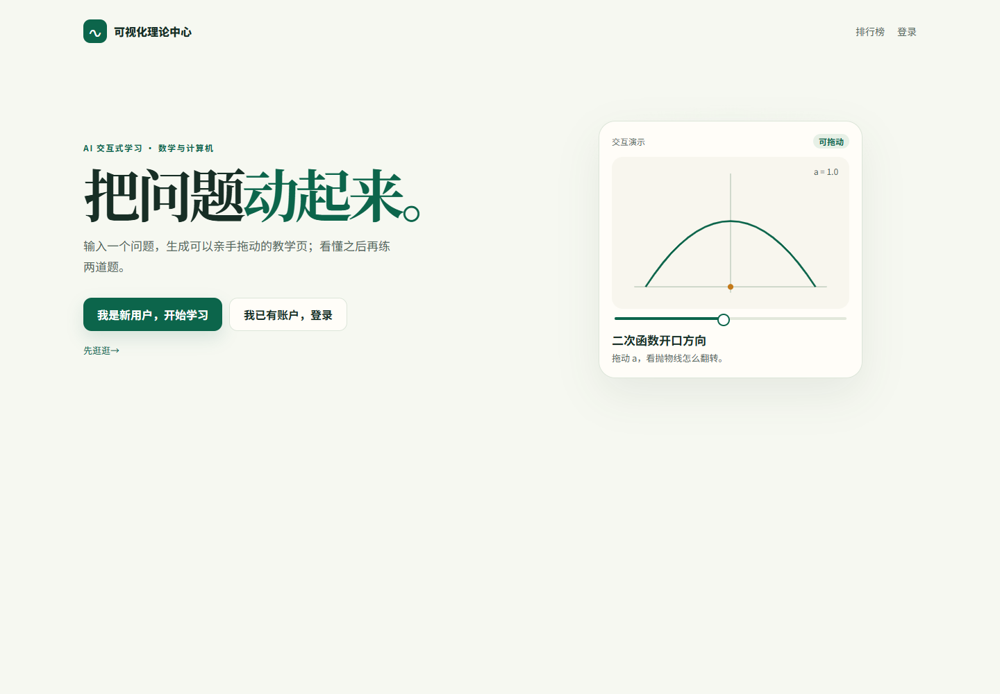
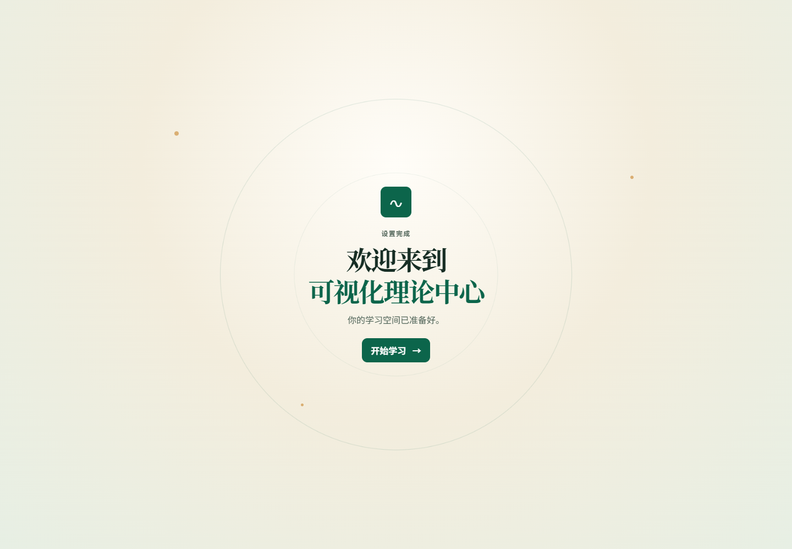
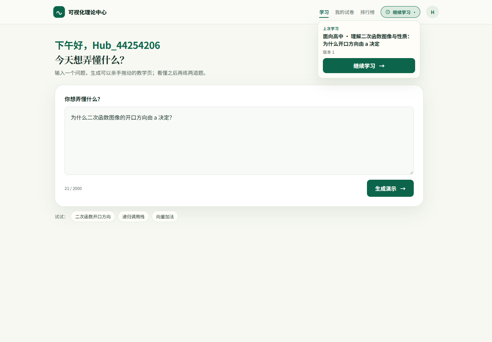
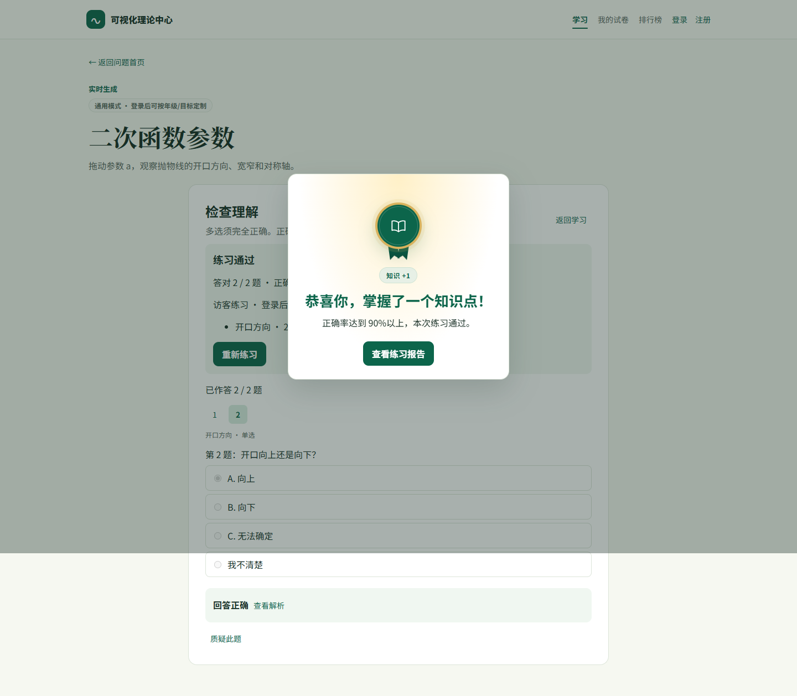
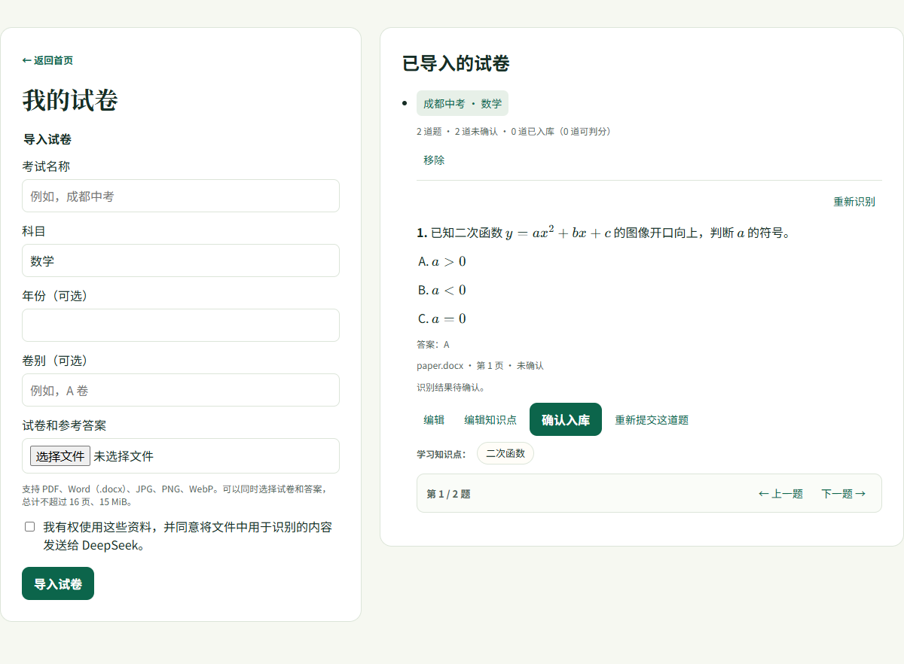
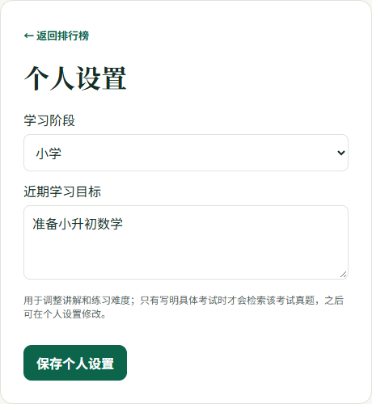

# 10 学习中心、练习徽章与导入试卷库

> 迭代日期：2026-11-13 至 2026-11-14
> 对话工具：DeepSeek Harness（DSH）
> 模型：`deepseek-flash` / `deepseek-v4-pro`（真实 API 与确定性浏览器夹具并存）
> 对应提交：`ea33272`、`1d9c5c1`、`0f2b9b1`、`03e7a0b`、`4166140`、`c50fd03`、`788110b`、`7d35c15`、`f786005`、`f3b0bc8`、`bd3079e`、`f7f9348`、`e45eb8c`、`06f60f0`、`1b8f07a`、`d6f9d7f`
> 相关测试：`pytest -q` 72 项、`npm run test:browser` 22 项、`npm run build`
> 对话原文：[DeepSeek 2026-11-14 导出](exports/deepseek-session-2026-11-14.md)

本文记录 2026-11-13 上一份会话导出之后的三组核心迭代：学习中心与继续学习、练习通过徽章、导入试卷逐题分页与宽屏。每组都保留“用户原话 → AI 诊断/方案 → 实现 → Bug 修复 → 复测”的完整过程。

## 背景

上一版已经打通：问题生成教学页、对话修改、选择题练习、三题巩固、真题检索、私有试卷导入、年级/目标个性化。接下来用户把重点转到“让前端界面好看又好用”，并逐步落到三个具体问题：

1. 学习首页和导航要有产品感，继续学习要随手可用；
2. 练习达到 90% 后要有一个“掌握知识点”的完成反馈；
3. 导入试卷的题目太多、详情重复、两栏太窄，需要逐题查看和更舒展的布局。

---

## 迭代一：学习中心、顶部导航与继续学习

### 用户 Prompt（原话）

> 现在我们一步一步讨论下前端界面，现在目标是让前端界面好看又好用。我觉得可以参考其他已经在市面上的产品设计。

AI 先给了三套方向（Brilliant 学习产品感 / Desmos + Linear 工具感 / Duolingo 游戏化），建议 **A+B 混合**：Brilliant 的学习节奏、Desmos 的画布、Linear 的信息层级，并保留米白 + 墨绿品牌色。随后做了欢迎 gate、两步引导、欢迎庆祝和品牌改名「可视化理论中心」。

接着用户继续提出更细的界面要求：

> 首页的交互演示目前没办法拖动。

> 我觉得这一块儿有点太大了，显得有点突兀。我们讨论下，结合下现在市面上有的方案，看看咱们修改更好看呢

> 我觉得要不把继续学习的部分移动到导航栏你觉得怎么样

> 我觉得点击继续学习后，可以下拉查看上一次学习的主题。你觉得这样怎么样

> 下午好，[账号]。这些字样我觉得排版到左边更好看一点，你觉得呢。以及“下午好，[账号]”这个子目前太小了和整体不是很搭配。我认为三行都保持一样的大小即可

> 输入一个问题字样可以小一点。其余没问题

> 我觉得这一块可以再往上挪一点。然后第二张图里的主要界面可以再大一点

> 主要的输入部分可以和第一版一样大，我感觉是最合适的，你觉得呢

> 我觉得还能在大一点，我们讨论下把

### AI 诊断与修改

1. **欢迎与引导**：新访客先看到欢迎 gate；注册与个人资料拆开；注册后两步引导（学习阶段 → 近期目标）；完成后欢迎庆祝，按钮 + 4 秒自动进入学习首页。提交 `ea33272`。
2. **欢迎页可交互**：把首屏抛物线做成可拖动参数 `a` 的预览（-1.5 到 1.5，开口向上/向下/变成直线），提交 `1d9c5c1`。
3. **顶部导航重构**：原来是「排行榜 / 用户名 / 我的试卷 / 个人设置 / 退出」纯文字链接；改为 `学习 / 我的试卷 / 排行榜` + 圆形头像下拉（用户名、阶段·目标、个人设置、退出）。提交 `0f2b9b1`。
4. **继续学习从首页卡搬到导航**：
   - 第一版是全宽大卡 + 长摘要，用户觉得“太大、突兀”；
   - 先改成 64px 紧凑横条 + 时钟图标（`03e7a0b`）；
   - 再移到导航栏胶囊（`4166140`）；
   - 再改为点击展开浮层，显示上次主题、版本和「继续学习」（`788110b`）。
5. **首页标题与输入区**：标题从左对齐 28px 到居中大标题，再到左对齐；输入卡 1060 → 1180/280 → 1000/160 → 1120/1080/200；最终按用户“和第一版一样大”的判断收敛到 1000/960/160，再按“A 档”放大到 1120/1080/200。提交 `c50fd03`、`788110b`、`7d35c15`、`f786005`。

### Bug 修复

- **输入框标签改名导致大面积测试失败**：把「你想弄懂什么？」改成「写下你的问题」后，`fixtures.ts` 和多个浏览器用例找不到输入框，18 项失败。修复：恢复标签文案，测试不改语义。
- **首页抛物线拖不动**：React 受控 `input` 直接赋值不会触发状态更新；改用原生 `HTMLInputElement.prototype.value` setter + `input` 事件，补浏览器交互测试。
- **首次注册流程超时**：新增欢迎/引导后首个用例超过 30 秒；将该用例超时调到 90 秒，避免把流程耗时误判为功能失败。
- **继续学习浮层与顶部导航**：透明背景/点击外部关闭、`aria-expanded`、移动端只留时钟图标；补开合、Esc、继续学习的测试。

### 证据

- 提交：`ea33272`、`1d9c5c1`、`0f2b9b1`、`03e7a0b`、`4166140`、`c50fd03`、`788110b`、`7d35c15`、`f786005`
- 截图：
  - 
  - 
  - 
- 对话原文：导出 [第 1 轮](exports/deepseek-session-2026-11-14.md#msg-03864)、[抛物线拖动](exports/deepseek-session-2026-11-14.md#msg-04269)、[继续学习过大](exports/deepseek-session-2026-11-14.md#msg-04658)、[继续学习移到导航](exports/deepseek-session-2026-11-14.md#msg-04869)、[下拉与左对齐](exports/deepseek-session-2026-11-14.md#msg-04964)、[输入区尺寸](exports/deepseek-session-2026-11-14.md#msg-05207)。

---

## 迭代二：练习通过 90% 的「知识徽章」

### 用户 Prompt（原话）

> 我想打完练习题并且达到正确率90%后，系统生成一个动画，显示恭喜你，掌握了一个知识点！和正确答完错误题生成的三道题一样的动画效果

> 文案「正确率达到 90%以上，本次练习通过。」
> 主练习全部作答且 report.passed === true（正确率 ≥ 90%）时，弹出的效果也可以有三颗星的动画，或者你觉得有什么其他的好的想法吗

> 不需要加星，直接用点亮一个徽章的感觉效果也可以啊。你觉得呢

> 继续

> 我想让这个弄成一个徽章的感觉，不是一个对号。我们讨论下呢

> 奖章 + 绶带 + 「书本」 这种感觉会不会好一点

### AI 诊断与修改

- 现有 `CelebrationNotice` 已有三题巩固的彩带 + 三颗星效果，但主练习通过只有静态「练习通过」报告。
- 先复用 `CelebrationNotice`，增加 `title` / `message` / `showStay` / `variant`：
  - `report.passed` 且没有换题提示/三题巩固时弹出；
  - 用 `quiz-pass:<quizId>` 在 localStorage 去重，每个练习只弹一次；
  - 关闭后滚动并聚焦「练习报告」；
  - 三题巩固仍保留原有星星 + 彩带；通过改为 `variant="badge"`，无星星、无彩带。
- 徽章从绿色对号 → 金色外圈 + 深绿内盘 + 打开的书本 + 两条短绶带 + 光环/扫光 + 「知识 +1」。
- 提交：`f3b0bc8`（通过徽章）、`bd3079e`（奖章 + 书本 + 绶带）。

### Bug 修复

- **弹窗排队**：通过弹窗如果和最后一题的三题巩固同时出现，会互相遮挡；增加 `!celebration` 条件，先让巩固弹窗关闭，再弹通过。
- **「知识 +1」不居中**：`.quiz-pass-badge` 的 `margin: auto` 被 `.quiz-replacement-dialog p` 的 `margin: 10px 0 20px` 覆盖；增加 `.quiz-celebration-dialog .quiz-pass-badge` 高优先级规则。
- **浏览器用例超时**：首个用例在多轮欢迎/引导后超过 30 秒；延长到 90 秒，并在通过用例中断言徽章可见、`.quiz-stars` / `.quiz-confetti` 为 0。

### 证据

- 提交：`f3b0bc8`、`bd3079e`
- 截图：
- 对话原文：[通过要求](exports/deepseek-session-2026-11-14.md#msg-05351)、[文案调整](exports/deepseek-session-2026-11-14.md#msg-05398)、[不要星星](exports/deepseek-session-2026-11-14.md#msg-05427)、[徽章造型](exports/deepseek-session-2026-11-14.md#msg-05682)。

---

## 迭代三：导入试卷逐题分页、详情去重与宽屏

### 用户 Prompt（原话）

> 我想让点开导入的试卷的时候，题目一个一个显示，可以选择下一页切换到下一个题目。

> 保留最下方的就可以了，你咋生成两个呢...

> 咋有个这个

> 题目截图.png、题.png
> 0 道未确认 · 5 道已入库（0 道可判分）

> 这不是在已导入的下面已经有了吗

> 这里第一张图里的知识点的形式，不要使用这种下划线的方式。我认为可以换成第二章截图里的主界面里的这种格式
> 第四张图里的整个格式，我觉得我的试卷和已导入的试卷占据整个屏幕有点少了，留白有点太大了。我们讨论下呢，我认为可以把两个板块的宽度增大一点，你觉得呢？

> 除了这些修改以外，当前点击个人设置页面后，返回按钮上的字样始终保持返回首页，但是和功能不匹配，我们想让字样是返回上一页点击的页面，和我的试卷和排行榜一样的感觉

### AI 诊断与修改

1. **逐题分页**：新增 `questionIndex`、`showQuestion`、`questionPager`；`openPaper`/导入新试卷时回到第 1 题；题目数量变化时夹取题号；编辑、编辑知识点、单题重新识别、请求中禁用分页；切换后滚动到题目顶部。
2. **只留底部**：第一版做了顶部 + 底部两条分页，用户指出重复；删除顶部，只保留题目下方的 `第 X / N 题 + 上一题/下一题`（`06f60f0`）。
3. **详情去重**：原来列表项下面又渲染一份标题/文件名/统计；把详情嵌进当前试卷项，去掉重复头，只留右上角「重新识别」+ 题目 + 底部分页（`1b8f07a`）。
4. **新导入试卷不显示**：详情嵌入列表项后，新导入试卷没有加进 `papers` 列表，导致列表为空、详情不渲染；`updatePaper` 改为不存在时 `[paper, ...current]` 插入。
5. **知识点胶囊**：把默认带下划线的「学习XX」改成 `tag-links` + `tag-pill`（「学习知识点：」+ 知识点名），保留 `aria-label="学习XX"` 和点击行为。
6. **双栏加宽**：`.exam-library` 从 860 改为 1200，左栏 480、右栏 1fr、间距 24；920px 以下单栏。
7. **设置返回文案**：`returnLabel` 原来对整串做精确比较；从排行榜/试卷进入设置时 `from` 带 query（如 `/leaderboard?from=...`），匹配不到，回退「返回首页」。改为 `value.split('?')[0]` 后再匹配；实际返回目标不变，补「排行榜 → 设置 → 返回排行榜」测试。

### 证据

- 提交：`e45eb8c`、`06f60f0`、`1b8f07a`、`d6f9d7f`
- 截图：
  - 
  - 
- 对话原文：[逐题分页](exports/deepseek-session-2026-11-14.md#msg-05987)、[只留底部](exports/deepseek-session-2026-11-14.md#msg-06208)、[重复详情](exports/deepseek-session-2026-11-14.md#msg-06290)、[知识点与宽屏](exports/deepseek-session-2026-11-14.md#msg-06459)、[设置返回文案](exports/deepseek-session-2026-11-14.md#msg-06485)。

---

## 复测与提交

- `npm run build`：通过；
- `npm run test:browser`：**22 项通过**（含欢迎/引导、继续学习浮层、练习通过徽章、逐题分页、宽屏胶囊、上下文返回）；
- `pytest -q`：**72 项通过**；
- 最近代码提交：`d6f9d7f`；
- 本文档与导出为参赛材料补录提交，不改业务代码。

> 说明：本轮对话从上一份 `deepseek-session-2026-11-13.md` 的截止处（seq 3864）续接；导出保留用户 Prompt、AI 可见回复和 `exit_plan_mode` 方案，省略 reasoning、工具输出和系统运行时消息，并对密钥、本机路径、邮箱、演示账号做了脱敏。
