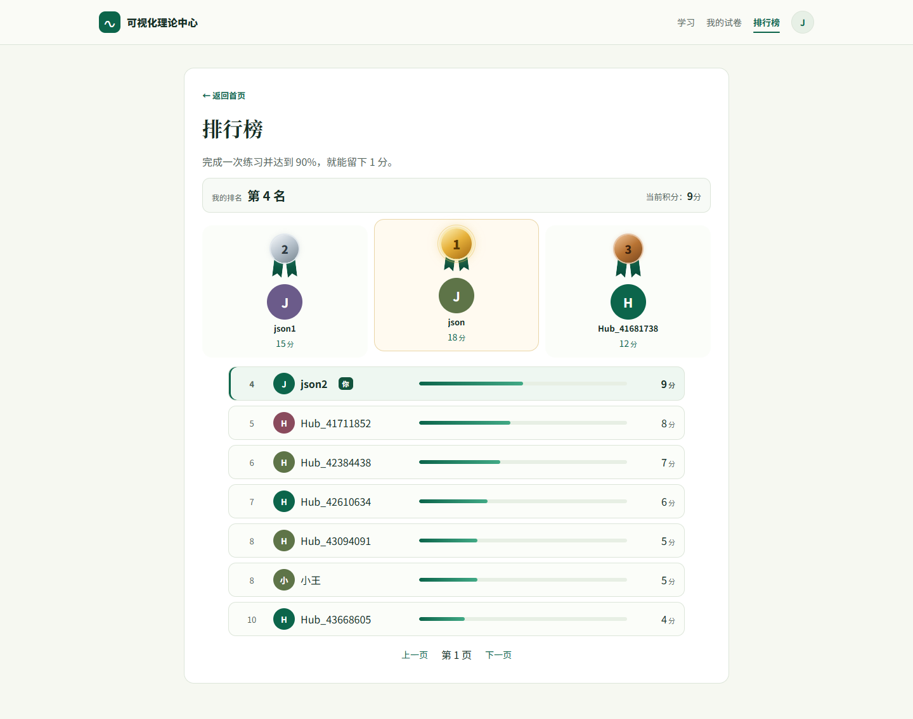
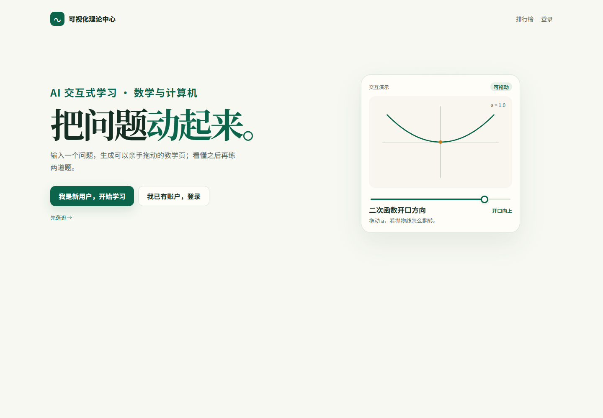
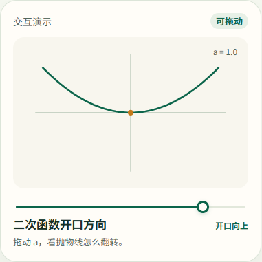

# 14 排行榜与欢迎页的视觉层级

> 迭代日期：2026-11-14  
> 对话工具：DeepSeek Harness（DSH）  
> 模型：`deepseek-flash`  
> 对应提交：`d77f8c0`、`bff9371`、`d11c2ba`、`006cb2a`、`b7c277d`、`58a08d2`、`d67dc81`、`6f34ade`  
> 相关测试：`pytest -q` 77 项、`npm run test:browser` 23 项、`npm run build`

## 用户 Prompt（原话）

> 前三名应该用金银铜牌的徽章，在会续航里面分别标注123。且应该有金银铜的显示区分，金牌最耀眼，银牌次之，铜牌次于银牌后

> 查看名次前的分数应该写成：当前积分：0分

> 名次 学习者 积分。这三个表头字样太小，而且应该居中在下方的信息的位置是最合适的。当前太靠左了。

> 我想实现类似奖牌的那种徽章，不是这样的。你参考下市面上的呢。我们讨论下

> 目前这个表格里的具体学习者排列上，歪来歪去的，尤其是第二章截图里的json1的信息。需要把这部分弄得整齐一点，我认为靠左更合适一点

> 紧凑行卡片可以，但是现在中间的右边部分留空太大了，看上去很奇怪

> 固定名字列的方案更好，然后在注册界面限制用户名满足2-16个字符的限制，这样系统里的用户名都在2-16个字符内。你觉得怎么样

欢迎页两轮：

> AI 交互式学习 · 数学与计算机 这一页的这行字有点小，我觉得需要把他设置的比 把问题动起来。 小一些，比 输入一个问题，生成可以亲手拖动的教学页；看懂之后再练两道题。 大一点

> 我指的 交互演示 可拖动 这两个字样，其实当前的板块大小是合适的我感觉，你觉得呢

> 举得只需要在现有的基础上调整字体大小就好了，你觉得呢，我们讨论下

## AI 建议

- 前三名用「金 / 银 / 铜」三种金属质感 + 短绶带，数字 1/2/3 由领奖台位置决定；表格里的名次仍用后端真实并列名次。
- 第四名之后放弃 960 宽的三大列表格：先做窄表格、两行卡片、行卡片对比，最终选 `A3`：720 宽行卡片 + 相对榜首的进度条。
- 进度条上限不固定，**当前榜首 = 100%**；非零最低 2%，0 分空轨道；后端返回 `top_points`，跨页也以全局榜首为基准。
- 进度条不按名字长度漂移：固定 220px 身份列，长名字省略并保留 `title`；注册用户名限制 2–16，登录保留 2–24 兼容旧账号。
- 欢迎页 eyebrow 不做装饰性大改，只把 12px 提到桌面 24px / 移动 16px，介于副文案和主标题之间；右侧「交互演示 / 可拖动」只调字号，不换色、不加实心胶囊、不动卡片。

## 实现

- 排行榜：
  - `d77f8c0`：领奖台重做；
  - `bff9371`：奖牌数字、表格对齐；
  - `d11c2ba`：奖牌绶带；
  - `006cb2a`：学习者列左对齐；
  - `b7c277d`：行卡片 + 相对榜首进度条 + `top_points`；
  - `58a08d2`：固定 220px 身份列、`title` 全名、用户名 2–16。
- 欢迎页：
  - `d67dc81`：eyebrow 层级；
  - `6f34ade`：`交互演示` 14px、`可拖动` 13px。
- 测试：
  - 排行榜前三名奖牌、当前积分、进度条、分页、用户名长度；
  - 浏览器 23 项，后端 77 项。

## Bug 与踩坑

- **表格越调越怪**：根因不是左右对齐，而是 960 宽 + 只有三列 + 巨大中缝。改为 720 行卡片 + 进度条后，空间被用来表达「离榜首多远」。
- **Vite HMR 未生效**：CSS 改了但计算样式仍是 `left`/`right`；重启 Vite 后确认 `th/td` 居中、进度条对齐。
- **头像漂移**：整组 `avatar+name` 居中会随名字长度左右移动；最终固定身份列宽，头像起点和进度条起点都稳定。
- **测试名称超长**：用户名限制 2–16 后，测试夹具 `Settings_...` 变成 17 字符；改为 `Setting_...`，并补 2 字符通过 / 17 字符拒绝。
- **欢迎页字号**：eyebrow 从 12 直接跳到 24 会压过副文案；按用户要求逐级调整并截图对比，而不是重做整块。

## 证据

- 提交：`d77f8c0`、`bff9371`、`d11c2ba`、`006cb2a`、`b7c277d`、`58a08d2`、`d67dc81`、`6f34ade`
- 截图：
  - 
  - 
  - 
- 测试：`pytest -q` 77 项、`npm run test:browser` 23 项、`npm run build`
